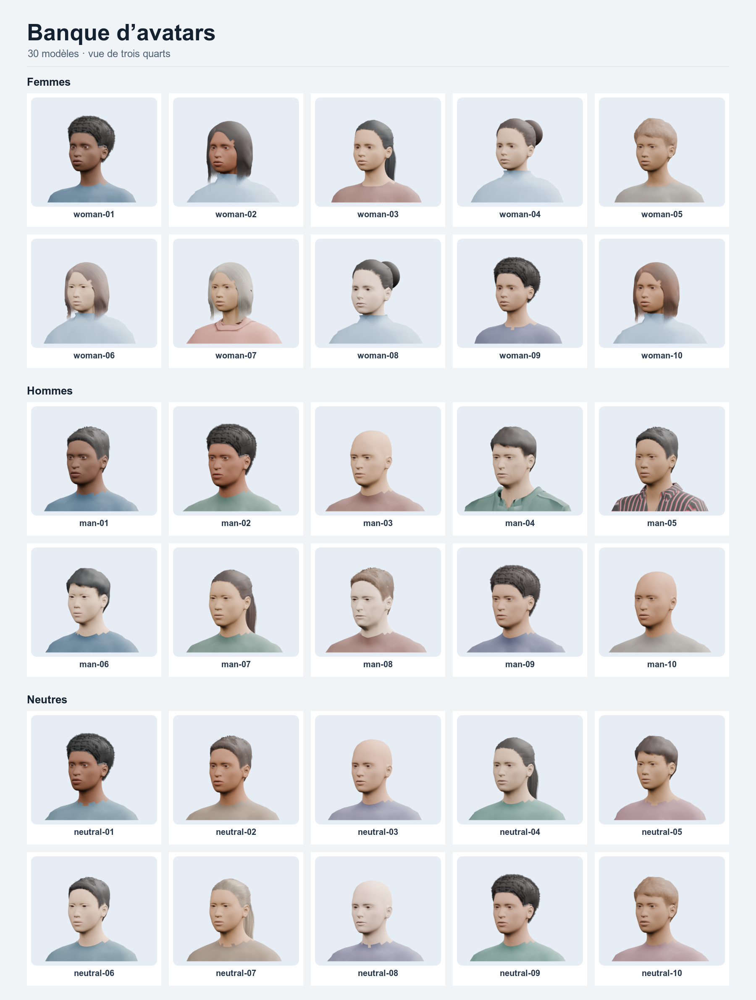

# Claude Demo Maker

Deux skills Claude Code pour produire des démonstrations vidéo. `/demo-maker` enregistre un parcours web avec Playwright et incruste un dialogue de 1 à 4 intervenants. `/avatar-narrator` fait parler des avatars Blender à partir d’un texte ou d’un enregistrement. Le dépôt contient les scripts et 30 avatars réutilisables.

## Installer les skills

1. Installe [Claude Code](https://code.claude.com/docs/en/setup#install-claude-code).
2. Clone le dépôt en remplaçant `URL_DU_DEPOT` par son URL de publication.

   ```bash
   git clone URL_DU_DEPOT claude-demo-maker
   cd claude-demo-maker
   ```

3. Lance `claude` depuis cette racine. Dans la session, tape `/demo-maker` ou `/avatar-narrator`. Claude Code découvre automatiquement les skills sous `.claude/skills/` et peut aussi les activer à partir d’une demande en langage naturel. [Documentation des skills Claude Code](https://code.claude.com/docs/en/skills)

Pour installer les deux skills dans un autre dépôt, exécute ces commandes à la racine du clone. Remplace le chemin de destination par la racine de ton projet.

```bash
target_repo="/chemin/vers/autre-projet"
mkdir -p "$target_repo/.claude/skills"
cp -R .claude/skills/avatar-narrator .claude/skills/demo-maker "$target_repo/.claude/skills/"
```

Lance ensuite Claude Code depuis le dépôt de destination. Les scripts calculent la racine de travail à partir de l’emplacement de la skill, donc conserve l’arborescence `.claude/skills/avatar-narrator/` du projet. Ajoute `.scratch/` à son `.gitignore` pour garder les rendus et le cache hors de Git.

## Installer les dépendances de rendu

| Dépendance | Usage |
| --- | --- |
| [Node.js](https://nodejs.org/) 22 ou plus récent | Exécution des scripts JavaScript. |
| [Python 3](https://www.python.org/) | Lancement de Blender et composition des portraits. |
| [Blender](https://www.blender.org/download/) avec Eevee | Rendu des avatars sur la machine hôte. |
| [FFmpeg](https://ffmpeg.org/download.html) avec `ffprobe`, `libass` et `drawtext` | Traitement de l’audio, sous-titres et assemblage vidéo. |
| [Docker](https://docs.docker.com/get-started/get-docker/) | Synthèse vocale Kokoro à partir d’un texte. |
| [Rhubarb Lip Sync 1.14.0](https://github.com/DanielSWolf/rhubarb-lip-sync/releases/tag/v1.14.0) | Calcul des mouvements de bouche à partir de l’audio. |

Télécharge l’archive Rhubarb adaptée à ton système, extrais-la en conservant son contenu ensemble, puis indique le chemin absolu de l’exécutable. Le binaire n’est pas versionné dans le dépôt.

```bash
export RHUBARB_BIN="/chemin/vers/rhubarb"
"$RHUBARB_BIN" --version
```

Si Blender est installé hors du `PATH` et de l’emplacement standard, indique le chemin de son exécutable dans `BLENDER_EXE`. Pour les portraits circulaires, installe Pillow dans l’environnement utilisé par `python3`.

```bash
python3 -m venv .scratch/avatar-venv
source .scratch/avatar-venv/bin/activate
python3 -m pip install Pillow
```

Démarre Docker avant une synthèse vocale. Au premier lancement, les scripts récupèrent si nécessaire l’image `ghcr.io/remsky/kokoro-fastapi-cpu:v0.10.0` et démarrent Kokoro sur `127.0.0.1:8880`. Un enregistrement existant peut servir directement de source audio.

Vérifie les outils avant de lancer Claude Code depuis le même terminal, pour que la session hérite de `RHUBARB_BIN`, des éventuels réglages Blender et de l’environnement Python.

```bash
node --version
python3 --version
ffmpeg -hide_banner -filters | grep -E 'drawtext|subtitles'
ffprobe -version
docker info
claude
```

## Installer Playwright pour les démos web

Depuis la racine qui contient les deux skills, installe Playwright dans le dossier de travail local et télécharge le Chromium correspondant.

```bash
npm install --prefix .scratch/demo-playwright playwright@1.64.1
npm --prefix .scratch/demo-playwright exec -- playwright install chromium
```

Lance Claude Code depuis une session locale avec accès à l’interface graphique, puis tape `/demo-maker`. Après le brief, un navigateur Chromium et Playwright Inspector s’ouvrent. Dans Inspector, clique sur **Record**, effectue le parcours dans l’onglet principal, arrête l’enregistrement des actions et copie le JavaScript dans un fichier du dossier de la démo. Clique ensuite sur **Resume** pour fermer la prise et sauvegarder la vidéo. Claude proposera un dialogue avant le rendu. [Guide de la skill demo-maker](.claude/skills/demo-maker/SKILL.md)

## Faire un premier essai avec Avatar Narrator

Dans Claude Code, envoie cette demande pour tester l’activation automatique et produire un court rendu.

> Fais dire « Welcome to the demo » à l’avatar woman-03 avec synchronisation labiale. Prépare un aperçu MP4 dans `.scratch/videos/premier-essai/`.

Tu peux également commencer la demande par `/avatar-narrator` pour choisir explicitement la skill. Les paramètres des scripts, les exemples de configuration et la procédure de reconstruction de la banque d’avatars sont détaillés dans le [SKILL.md](.claude/skills/avatar-narrator/SKILL.md).

